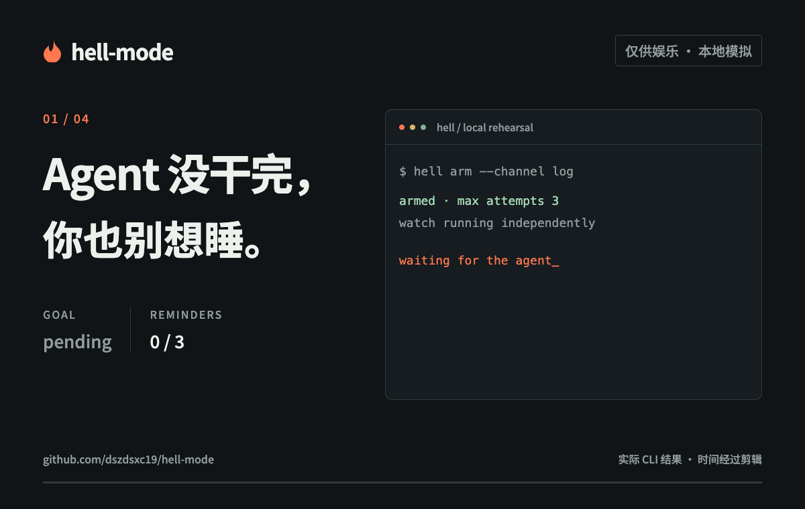
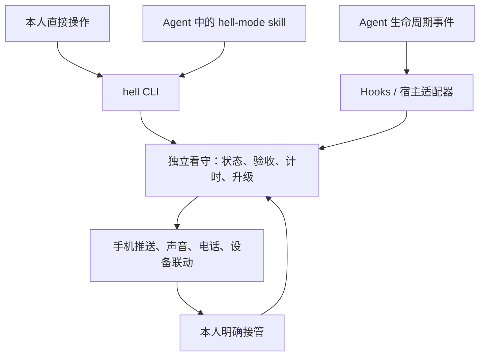

# 🔥 hell-mode

**Agent 没干完，你也别想睡**

[](https://github.com/dszdsxc19/hell-mode/actions/workflows/ci.yml)
[](LICENSE)

> [!NOTE]
> **仅供娱乐，请勿当真。** 本项目围绕 Agent 开发焦虑夸张玩梗，“半夜叫醒”“电话催命”等均为娱乐设想，不建议实际打扰睡眠或用于关键任务保障。玩梗归玩梗，该睡觉还是要睡觉。

你睡前开了一个 Agent 任务。凌晨三点，它卡住了、等你确认，或者自信地说「完成了」——但验收根本没过。

hell-mode 是面向 Agent 任务的值班系统。目标没达成，就按约定升级叫人：推送、响铃、打给自己的电话，直到你明确接管。

**当前阶段：Go CLI 初版。** 已实现本地任务、验收、独立看守进程、通知插件、Claude Code hooks 适配器与随包 skill。手机详情页、远程看守、电话和设备联动仍在路线图中；下文夜间剧情属于虚构设想。



演示来自真实 CLI 的 `log` 通道运行，时间经过剪辑；[静态画面](docs/assets/hell-mode-demo.png) · [演示源码与复现](media/demo/README.md)。

## 开始演练

需要 Go 1.23 或更高版本；当前运行验收以 macOS / Linux 为主。

```sh
git clone https://github.com/dszdsxc19/hell-mode.git
cd hell-mode
go build -o ./bin/hell ./cmd/hell
./bin/hell --help
./bin/hell schema --json
```

在一个终端运行独立看守：

```sh
./bin/hell --state-dir /tmp/hell-mode-demo watch --json
```

在另一个终端创建演练任务，将返回的 `data.id` 用作后续 `TASK_ID`：

```sh
./bin/hell --state-dir /tmp/hell-mode-demo arm \
  --goal '演练：验收应当失败' \
  --verify-json '["sh","-c","exit 1"]' \
  --deadline +10m --interval 5s --max-attempts 3 --window 1m \
  --channel log --yes --json

# 替换为上一条命令返回的 data.id
TASK_ID='task_...'
./bin/hell --state-dir /tmp/hell-mode-demo run "$TASK_ID" --json --no-input -- sh -c 'echo agent-finished'
./bin/hell --state-dir /tmp/hell-mode-demo status "$TASK_ID" --json
./bin/hell --state-dir /tmp/hell-mode-demo takeover "$TASK_ID" --json
```

示例中的验收故意失败，`run` 返回退出码 `3`；`log` 通道只记录演练结果，不发送真实通知。看守与任务共享状态目录，当前本地版本无法覆盖整机断电或休眠。

安装到 PATH、CI 预览二进制与 Windows 构建见 [安装说明](docs/install.md)。完整命令、JSON 输入、退出码与 Agent 用法见 [CLI 契约](docs/cli.md)。

| 能力 | 验证状态 |
| --- | --- |
| CLI、持久状态、独立看守、log 演练、子进程插件 | 已有本地回归与 CLI 子进程演练；CI 持续检查。 |
| Claude Code hooks 与 skill | 已有适配代码和样本回归，真实宿主安装与行为待验收。 |
| Pushover Emergency | 请求与取消已通过本地 HTTP 模拟，真实手机待验收。 |
| 手机详情入口、远程看守、电话与设备联动 | 尚未实现。 |

## 一个体系，五个组成

| 组成 | 职责 |
| --- | --- |
| CLI | 提供统一操作入口：配置、布防、执行、查询、验收、接管、暂缓与解除布防。 |
| Hooks / 宿主适配器 | 把 Agent 的生命周期事件映射为任务事件，自动上报结束、等待或失败等信号。 |
| Skill | 理解「这个任务没做完就叫醒我」，协助约定目标和策略，再调用 CLI 开启监看。 |
| 独立看守 | 持久保存任务状态，编排验收，检查心跳和截止时间，调度升级通知。 |
| 通知通道 | 执行推送、声音、电话或设备联动，返回回执与取消结果。 |



CLI 与 skill 使用同一套操作能力，hooks 负责提交运行信号。所有入口共用看守中的任务状态和验收规则，计时与重复通知由常驻程序持续执行。

CLI 可直接使用；`hell setup` 可导出供审阅的 Claude Code hooks 配置片段和 Agent Skill。Skill 协助整理验收条件、截止时间和叫人策略，经本人确认后布防；后续监看独立于 Agent 对话运行。导出操作会保留现有宿主配置，实际合并与宿主实机验证由使用者完成。

## 一段虚构的地狱剧情

```text
23:40  你设定目标、验收条件和今晚的叫醒方式，然后去睡觉。
02:13  Agent 退出，声称任务已经完成。
02:14  验收失败：登录流程仍有 2 个回归用例未通过。
02:14  手机收到紧急通知，附失败摘要和任务入口。
02:15  你没接管，通知继续重复。
02:17  电话响起：「你有一个未完成的目标。它已经等了你三分钟。」
02:20  你选择「我来处理」，打开失败现场。本轮告警停止。
02:38  重新运行并通过验收，目标才被记录为达成。
```

电话属于后续玩法；首版先验证「失败检测 → 重复手机通知 → 人接管」这条链路。

## 地狱菜单

| 模式 | 玩法 |
| --- | --- |
| 假下班稽查 | Agent 的完成声明触发验收，验收结果决定是否达成目标。 |
| 装死检测 | 心跳失联、进程异常退出、等待人工输入，都有对应的叫人理由。 |
| 夜班催命符 | 没有接管就按预设阶梯重复提醒，后续可升级到本人电话。 |
| 五分钟赎命券 | 暂缓必须有到期时间；到点仍未处理，恢复告警。 |
| 清醒证明 | 可选：读完失败摘要、选择处理方式后接管，减少半睡半醒的误触。 |
| 书桌签到 | 实验：走到电脑前扫码，直接进入需要处理的任务。 |
| 房间值班室 | 实验：联动本人配置的灯和音箱，让失败拥有存在感。 |
| 天亮追债 | 早上给自己一份未完成目标、暂缓次数和实际处理记录。 |

更多设想见 [玩法脑暴](docs/brainstorm.md)。

## 核心规则

- **先约定验收，再开始任务。** 首版使用本人配置的确定性检查；没有足够证据就记录为「无法确认」。
- **接管与完成分别记录。** 点开推送、接通电话、停止响铃，都不能把失败任务变成成功。
- **每次任务单独布防。** 通知本人已验证的设备与号码，预先展示升级节奏、次数和费用上限。
- **停止权始终可用。** 支持接管、到期暂缓和立即解除布防；保留真实的未完成状态。
- **监工也要有人看。** 夜间依赖常在线的独立看守；仅在笔记本本机运行无法覆盖本机休眠或断电。

「一定把人叫醒」是夸张设定。关机、网络、系统权限、设备设置和运营商都会影响通知触达，实验中的渠道表现须通过实机演练验证。

## 当前实现

当前代码提供以下使用路径：

1. CLI 或 skill 绑定目标、验收命令、截止时间与叫人策略，由本人确认布防。
2. 任务包装器提供执行结果与心跳，首个宿主的 hooks 补充生命周期事件；一轮响应结束会触发核对，目标是否达成由验收决定。
3. 独立看守在失败、失联或截止时间到达时核对证据，通过所选通道执行有界提醒；默认 log 只记录模拟结果。
4. 本人通过 CLI 接管、限时暂缓、解除布防或重新验收。
5. 用演练模式验证重启恢复、重复事件、通知失败，以及 Agent 停止后看守仍可叫人。

通知实现包括默认 `log` 演练通道、[Pushover Emergency](https://pushover.net/api#priority) 适配器，以及显式注册的子进程插件。Pushover 的请求与取消已通过本地 HTTP 回归，尚未进行真实手机验收。

插件使用带版本号的 JSON/stdin/stdout 协议，支持 `describe`、`notify` 和 `cancel`；示例插件与 Go 协议类型随仓库提供，其他语言也可实现。注册前可预览 manifest，插件日志与 CLI JSON 结果分离。见 [插件开发](docs/plugins.md)。

后续按宿主分别提供插件安装包；MCP 在确有远程工具调用需求时加入。

## 继续往下看

- [玩法脑暴](docs/brainstorm.md)：把地狱程度拉满，再区分哪些值得做。
- [MVP 设计](docs/mvp.md)：领域关系、触发条件、接管语义与验收场景。
- [CLI 契约](docs/cli.md)：人和 Agent 共用的 help、schema、输入输出与退出码。
- [安装说明](docs/install.md)：源码、PATH、CI 预览构建与平台限制。
- [插件开发](docs/plugins.md)：manifest、子进程协议、能力声明与示例。
- [路线图](docs/roadmap.md)：从可演练的叫人链路走到电话和房间联动。
- [领域术语](CONTEXT.md)：统一目标、布防、告警与接管的含义。

欢迎围绕真实的夜间 Agent 失败经历提改进。开发与提交方式见 [贡献指南](CONTRIBUTING.md)；共享日志前请去掉密钥、代码和个人信息。

## License

[MIT](LICENSE)
