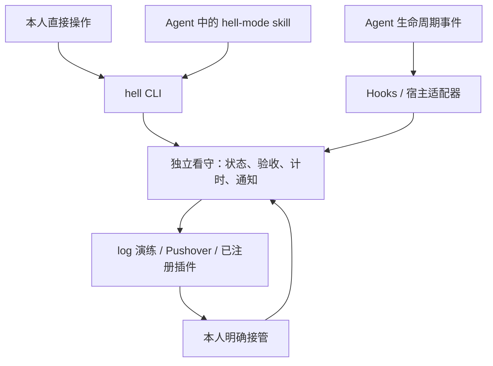

# 🔥 hell-mode

**Agent 没干完，你也别想睡**

[](https://github.com/dszdsxc19/hell-mode/actions/workflows/ci.yml)
[](LICENSE)

> [!NOTE]
> **仅供娱乐，请勿当真。** 本项目围绕 Agent 开发焦虑夸张玩梗，不建议实际打扰睡眠或用于关键任务保障。演练默认使用不发送真实通知的 `log` 通道。

给 Agent 派一个任务，约定目标和验收条件，然后让独立看守盯着它。异常退出、失联、验收失败，需要你时就通知你。Agent 说做完了，验收未必同意。

**默认素质低。** 嘴欠、爱拆台、没眼力见：验收失败时说「验收没过，先别急着散会」；Agent 失联时说「它没留辞职信」；你回来时说「回来了？事情也还在」。主动对话和质疑模式让 AI 根据真实话柄接话、反问和吐槽。有趣本身也是价值，说停就停。

**当前阶段：Go CLI 初版。** 已实现本地任务、确定性验收、独立看守、主动对话、通知插件、Claude Code hooks 适配器与随包 skill。

| 想做什么 | 入口 |
| --- | --- |
| 让 AI 根据记忆主动问你问题、给你小行动 | [主动对话](docs/engage.md)：保存关注与背景，预览并启用定时计划。 |
| 让 Agent 持续质疑你的判断 | [质疑模式](docs/challenge.md)：加载 skill，在当前对话中开始。 |
| 监看 Agent 的任务与验收结果 | [本地演练](#开始演练)：默认使用 `log` 通道。 |
| 安装 CLI 或把 skill 放进其他项目 | [安装说明](docs/install.md)。 |

## 让 AI 主动来找你

对 AI 的输入，也是人的表达与行动。`hell engage` 把发起权交给 AI：按你设定的间隔，读取你保存的个人记忆、关注方向与之前的回答，提出一个问题或一项小行动。例如，你保存了「最近想练习技术表达」，它可以邀请你用三句话讲清今天的一次技术取舍。

生成由你指定的 AI 命令执行；看守保存每轮内容与依据，再通过已有通道发出一次通知。你回答或跳过后，才安排下一轮；没有回应时留在原地等待。你可以随时暂停，`vanish` 和 `end` 也会停用主动对话计划。

配置、协议演练与真实 AI 接入见 [主动对话指南](docs/engage.md)。默认 `log` 通道记录演练结果；本地看守需要持续运行，电脑休眠期间无法执行。

## 也可以，让 Agent 质疑你

`hell-challenge` 是一个持续追问的独立 skill：抓住你的前提、证据和矛盾，根据你的回答继续问。你换个说法，它会追问缺失的依据；你给出充分论证，它会接受。每轮优先一个关键问题，你可以随时暂停、结束或切回执行。

在本仓库的 Agent 会话中，直接说：

```text
读取 assets/skills/hell-challenge/SKILL.md，开启持续质疑模式。
我的主张是：我想做一个不断质疑用户的 AI。
```

CLI 也提供 `hell challenge '你的主张' --json`，返回规则与可选话题，由当前 Agent 加载后开始提问。省略话题时沿用当前对话。命令不调用模型，也不创建监看任务。

对话示例、暂停与切回执行见 [质疑模式指南](docs/challenge.md)；跨项目安装与更新见 [skill 安装说明](docs/install.md#安装质疑-skill)。

## 凌晨 02:14

```text
23:40  你给 Agent 设定目标，安排好看守，离开电脑。
02:13  Agent 退出，声称任务已经完成。
02:14  验收失败：还有两个回归用例未通过。
02:14  你收到失败消息，拿起手机。
02:15  你没有接管，看守继续提醒。
02:20  你说：「再试一次。」
02:21  你开始等下一条消息。
```

剧情虚构。当前 CLI 支持本地演练，Pushover 手机通道已通过 HTTP 模拟，真实手机触达仍待验收。

## 开始演练

需要 Go 1.23 或更高版本；当前运行验收以 macOS / Linux 为主。

```sh
git clone https://github.com/dszdsxc19/hell-mode.git
cd hell-mode
go build -o ./bin/hell ./cmd/hell
./bin/hell --help
./bin/hell schema --json
```

在一个终端运行独立看守：

```sh
./bin/hell --state-dir /tmp/hell-mode-demo watch --json
```

在另一个终端创建演练任务，将返回的 `data.id` 用作后续 `TASK_ID`：

```sh
./bin/hell --state-dir /tmp/hell-mode-demo arm \
  --goal '演练：验收应当失败' \
  --verify-json '["sh","-c","exit 1"]' \
  --deadline +10m --interval 5s --max-attempts 3 --window 1m \
  --channel log --yes --json

# 替换为上一条命令返回的 data.id
TASK_ID='task_...'
./bin/hell --state-dir /tmp/hell-mode-demo run "$TASK_ID" --json --no-input -- sh -c 'echo agent-finished'
./bin/hell --state-dir /tmp/hell-mode-demo status "$TASK_ID" --json
./bin/hell --state-dir /tmp/hell-mode-demo takeover "$TASK_ID" --json
```

示例中的验收故意失败，`run` 返回退出码 `3`；`log` 通道只记录演练结果，不发送真实通知。看守与任务共享状态目录，当前本地版本无法覆盖整机断电或休眠。结束演练可在看守所在终端按 Ctrl-C。

安装到 PATH、CI 预览二进制与 Windows 构建见 [安装说明](docs/install.md)。完整命令、JSON 输入、退出码与 Agent 用法见 [CLI 契约](docs/cli.md)。

## 任务监看：五个组成

| 组成 | 职责 |
| --- | --- |
| CLI | 提供配置、布防、执行、查询、验收与告警处理入口，支持 help、schema 和 JSON。 |
| Hooks / 宿主适配器 | 把 Agent 的生命周期事件映射为任务事件，上报结束、等待或失败等信号。 |
| Skill | 协助约定目标和通知策略，读取命令契约，按本人指令操作 CLI。 |
| 独立看守 | 保存任务与证据，编排验收，检查心跳和截止时间，调度有界提醒。 |
| 通知通道 | 执行通知，返回回执与取消结果；通过显式注册的子进程插件扩展。 |



CLI 与 skill 使用同一套操作能力，hooks 负责提交运行信号。计时与重复通知由独立进程执行；Agent 对话结束后，看守仍可继续运行。

`hell setup` 导出供审阅的 Claude Code hooks 配置片段，以及 `hell-mode`、`hell-challenge` 两份 skill。`hell-mode` 协助配置任务监看与主动对话，`hell-challenge` 可独立用于质疑对话。宿主安装与现有配置合并见 [安装说明](docs/install.md)。

## 当前实现与验证

目标契约在布防前约定，验收使用本人配置的确定性检查。没有足够证据时记录为「无法确认」。接管、通知回执与目标完成分别记录；点开消息不会把失败改成成功。

| 能力 | 验证状态 |
| --- | --- |
| CLI、持久状态、独立看守、log 演练 | 已有本地回归与 CLI 子进程演练；CI 持续检查。 |
| Claude Code hooks 与监看 skill | 已有适配代码和样本回归，真实宿主安装与行为待验收。 |
| `hell-challenge` 与 `challenge` 入口 | CLI、导出与无状态副作用有回归；独立 Agent 场景试跑已覆盖追问、接受证据、个人取舍与暂停，跨宿主持续效果待验证。 |
| `hell engage` 主动对话 | 合成记忆、演练回答与 Claude Code 2.1.287 的两轮 `log` 演练通过；长期相关性与真实手机触达待验收。 |
| 默认素质低的人格 | 通知事实、重启后的尝试次数和结束收尾有回归；Claude Code 2.1.308 完成三轮主动对话与四轮质疑规则回放，覆盖接话、接受证据和叫停。 |
| Pushover Emergency | 请求与取消已通过本地 HTTP 模拟，真实手机待验收。 |
| 子进程通知插件 | 版本化 JSON 协议、manifest、超时、错误处理与模拟插件已有回归。 |

每次任务单独布防，预览接收设备、间隔、次数与有效时间。接管、暂缓和解除布防始终可用。关机、网络、设备设置和供应商限制会影响通知触达，实验中的渠道表现须通过实机演练验证。

插件支持 `describe`、`notify` 和 `cancel`，其他语言也可实现。核心维护任务与验收，插件执行指定通知动作。见 [插件开发](docs/plugins.md)。

## 一次本地演练


演示来自真实 CLI 的 `log` 通道运行，时间经过剪辑，只播放一次。[演示源码与复现](media/demo/README.md) · [静态画面](docs/assets/hell-mode-demo.png)。

## 项目资料

- [质疑模式](docs/challenge.md)：加载、对话示例、暂停、切回执行与效果排查。
- [主动对话](docs/engage.md)：个人记忆、定时邀约、回答与生成协议。
- [MVP 设计](docs/mvp.md)：监看、主动对话与质疑的职责、现有功能与验收标准。
- [CLI 契约](docs/cli.md)：人和 Agent 共用的 help、schema、输入输出与退出码。
- [安装说明](docs/install.md)：CLI 构建、skill 安装更新、CI 预览构建与平台限制。
- [插件开发](docs/plugins.md)：manifest、子进程协议与示例。
- [路线图](docs/roadmap.md)：现有能力的维护与真实宿主验收。
- [早期玩法脑暴](docs/brainstorm.md)：创作档案，保留最初的地狱设想。
- [领域术语](CONTEXT.md) · [贡献指南](CONTRIBUTING.md) · [MIT License](LICENSE)。

## 这个项目写于凌晨

一次加班之后，我躺在床上，通过手机远程连接电脑，用语音指挥 AI 完成了这个项目。

代码在生成，提交在增加。我觉得自己像个老板。

我还在等它下一条消息。

## 番茄失踪

```sh
./bin/hell --state-dir /tmp/hell-mode-demo vanish --for 25m
```

人类暂不提供服务。任务可以继续，需要人的事情请保存并等待。倒计时结束后仍然安静，直到本人主动回来：

```sh
./bin/hell --state-dir /tmp/hell-mode-demo presence --json
./bin/hell --state-dir /tmp/hell-mode-demo back
```

回来不补发旧提醒，旧任务保持静默；重新监看须本人明确使用 `run --rearm`，主动对话计划须使用 `engage resume` 恢复。这组动作作用于同一状态目录的 hell-mode 通知，宿主自己的通知和权限弹窗仍由宿主控制。状态持久化、到期不自动返回、不补发及看守退出，已有回归与真实 CLI 演练验证。详细约定见 [CLI 契约](docs/cli.md#番茄失踪与今天结束)。

## 今天到此为止

你也可以结束今天。看守停止，运行中的 Agent 进程继续由宿主管理，任务与验收证据保留。

```sh
./bin/hell --state-dir /tmp/hell-mode-demo end
```

```text
任务未完成。

气势倒是下班了。

看守已停止。
```
