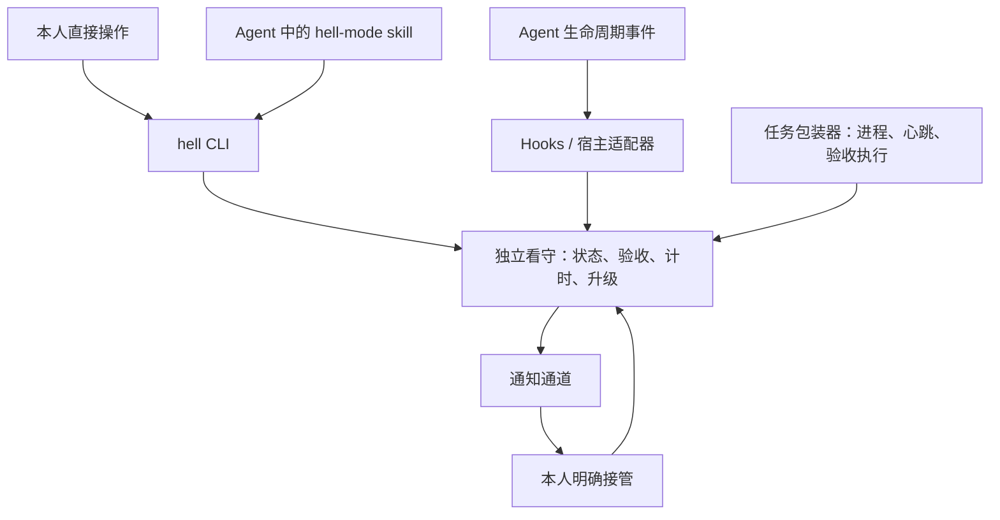
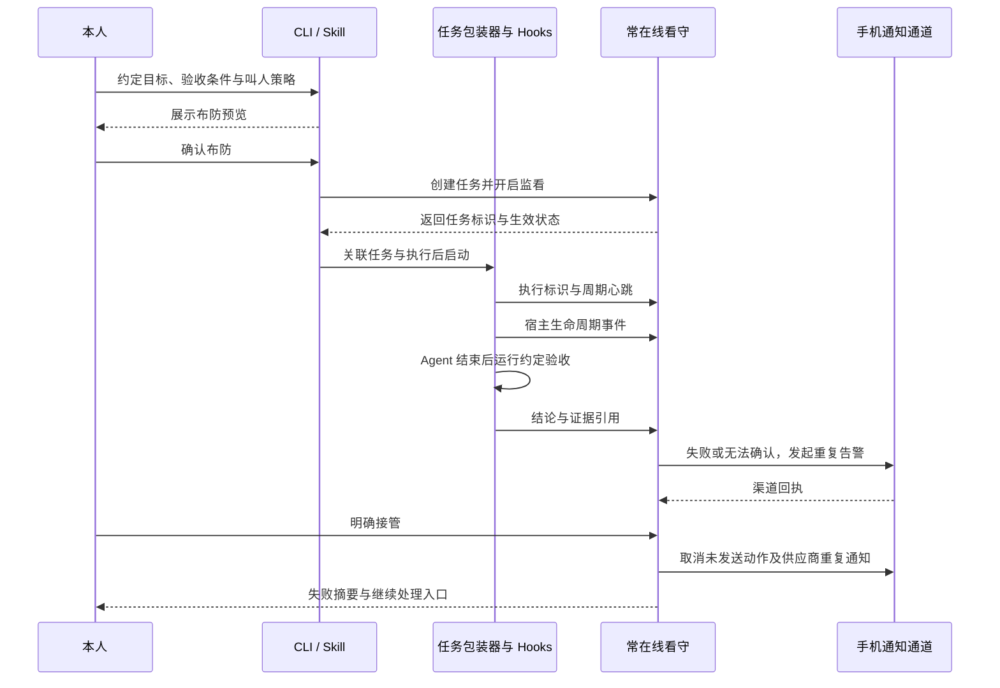

# MVP：任务可以未完成，今天可以结束

> **仅供娱乐。** 本文是玩梗项目的实验性设计，不建议实际打扰睡眠或用于关键任务保障。完整声明见 [README](../README.md)。

这个作品从「Agent 没干完，你也别想睡」开始，保留一个相反的出口：本人可以让系统停止召唤，任务证据照实留下。

## 本轮功能与验收

本轮只增加人的联系边界，复用已有 CLI、状态库、看守与取消协议。

| 功能 | 命令 | 验收 |
| --- | --- | --- |
| 番茄失踪 | `vanish --for 25m` | 同目录所有任务静默，取消已有回执；执行、验收和阻塞证据仍可保存。 |
| 约定时间到达 | `presence` 查询 | 仍显示 away，不响铃、不自动返回；重启看守也保持静默。 |
| 本人回来 | `back` | 恢复可联系状态，旧任务不补发、保持 quiet；重新监看须本人显式 rearm。 |
| 今天结束 | `end` | 看守退出，未完成记录保留；无原因表单、总结、次日自动恢复。 |

验收包括多个任务、失踪期间的新任务与新失败、迟到通知回执、并发看守、end 后立即 back、旧状态迁移，以及人和 Agent 的 help / JSON。演示以真实 log 通道执行并在片尾停止播放。GUI、统计评分、新通知渠道、远程服务不进入本轮。

## 既有任务监看

原始演练场景是：本人布防一个 Agent 任务；任务失联、异常结束、验收失败或超过截止时间时，独立看守按策略尝试通知；本人接管后停止本轮叫人，并拿到处理现场。新的全局人类边界优先于任务通知。

当前已有 Go CLI 初版：Cobra 组织命令，bbolt 保存本地事务状态，通知能力通过子进程协议扩展。下文同时描述目标设计与验收要求；已实现范围及缺口见 [路线图](roadmap.md)。

当前看守是与 Agent 独立的本地进程，和 CLI 共用状态目录。远程事件接入、手机详情页与独立管理端授权尚未实现；本机断电或休眠时，本地看守无法继续调度。

## 系统组成与职责

hell-mode 以任务、目标契约和验收结论为中心，由五个组成共同完成监看与接管。

| 组成 | 输入与输出 | 职责边界 |
| --- | --- | --- |
| CLI | 接收本人指令或受授权的自动化请求，提交操作并返回状态。 | 提供统一命令与结构化输出；通过同一套核心操作访问任务。 |
| Hooks / 宿主适配器 | 接收宿主生命周期事件，输出带任务与执行标识的标准事件。 | 完成事件映射与上报；升级计时、验收裁决和通知重试交给看守。 |
| Skill | 将自然语言要求整理为目标契约与叫人策略，再调用 CLI。 | 负责配置工作流、解释预览和读取状态；本人确认后布防。 |
| 独立看守（Core / Watchdog） | 接收操作、运行事件和验收证据，维护状态与通知计划。 | Core 提供核心规则，Watchdog 承载常驻运行；共用持久状态，负责验收编排、失联检测与升级调度。 |
| 通知通道 | 接收叫人动作，返回供应商回执、错误与取消结果。 | 执行具体触达；验收结论与接管状态由看守维护。 |

首个宿主适配器为 Claude Code，接入 Stop、StopFailure 及 permission_prompt / idle_prompt Notification，并通过事件样本回归。安装入口导出配置片段与 skill，保留现有宿主设置；真实宿主实机验收待完成。通用命令包装可运行其他 Agent。

## CLI 与 skill 的使用路径

下列命令已实现，详细 help、机器 schema 与输入输出见 [CLI 契约](cli.md)：

| 命令 | 计划行为 |
| --- | --- |
| `hell setup` / `hell doctor` | 导出 hooks 配置片段与 skill；检查本地状态、看守最近活动与凭据是否已配置，不发送测试通知。 |
| `hell arm` | 预览目标契约与叫人策略，确认后开启指定任务的监看。 |
| `hell run` | 包装本人指定的 Agent 命令，关联执行、心跳与结束后的验收。 |
| `hell status` | 返回任务、验收、告警与通知状态；支持结构化输出供 skill 使用。 |
| `hell verify` | 请求执行预先配置的验收，记录新结论与证据。 |
| `hell event` | 接收适配器提交的运行事件，交给看守校验与去重。 |
| `hell takeover` / `hell snooze` / `hell disarm` | 由本人执行接管、限时暂缓与解除布防。 |
| `hell watch` | 启动常驻看守，恢复持久任务与未完成的通知计划。 |
| `hell plugin add` / `list` / `remove` | 显式注册、查询或移除通知插件，不自动下载或删除插件程序。 |
| `hell schema` | 输出命令、参数、JSON 输入 schema 与退出码；不访问状态库。 |

Skill 的首次工作流是「理解要求 → 整理目标与策略 → 展示本人需确认的内容 → 调用 CLI 布防 → 返回任务标识与状态」。之后可读取任务状态、解释失败原因，按本人指令请求重新验收。

Skill 通过 CLI 工作，hooks 通过带执行令牌的事件入口工作。令牌只授权当前执行的事件提交，不能通过该入口更改策略或接管。当前管理命令仍依赖操作系统用户的状态目录权限；同一用户下运行的 Agent 与本人没有强隔离，人工管理行为由 skill 遵循用户指令，独立管理端授权留待后续实现。

## Hooks 与任务包装器

首个宿主适配器至少接入一种可验证的一轮响应结束事件；等待、权限请求和错误事件按该宿主实际能力逐项启用。每条事件绑定任务标识、执行标识与事件标识，保留来源和发生时间。

一轮响应结束后，看守核对当前执行与验收条件。Hook 本身只完成有界的事件提交，不在回调中等待本人接管或循环发通知。宿主事件缺失、未启用或上报失败时，任务包装器的心跳和看守的截止时间继续覆盖可观测范围。

包装器负责观察任务进程、发送周期心跳，并在任务环境中执行本人配置的验收命令。Hooks 补充对话生命周期信息；二者报告的同一结果按执行标识归并。存活心跳与业务进展分别记录，低频生命周期事件不充当周期心跳。

适配器实现前核对宿主官方事件语义，例如 [Claude Code Hooks](https://code.claude.com/docs/en/hooks)。Skill 采用包含工作流说明与必要资源的形式，参照 [Agent Skills](https://agentskills.io/home)。

## 任务的输入与输出

布防前固定一份目标契约和叫人策略。首版单人使用、单任务演练；通用命令包装与首个宿主适配器共用同一任务记录。

| 输入 | 约束 |
| --- | --- |
| 目标 | 用一句话说明要交付的结果。 |
| 验收条件 | 本人配置的检查命令、产物条件或明确人工验收项。首版先实现命令检查。 |
| 执行入口 | 本人在受信环境中指定的 Agent 命令与工作目录。 |
| 截止时间 | 明确到绝对时间；布防界面同时展示本地时区。 |
| 心跳期限 | 任务存活信号最晚何时必须到达；与业务进展分开记录。 |
| 叫人策略 | 本人设备、重复间隔、有效时间、次数及费用上限。 |
| 停止方式 | 接管、暂缓与解除布防入口；与该任务绑定。 |

输出保留目标契约、各次执行与验收结论、失败摘要、证据位置、通知尝试与本人操作。第三方通知默认只携带任务别名、失败类别和受保护的详情入口。

## 任务状态与事实

一个任务绑定一份目标契约，可包含多次执行与验收。同一任务的多个失败信号归入当前未解决告警，由本次布防的叫人策略安排通知。

任务的验收结论与告警处理状态分别保存：

| 维度 | 状态 | 含义 |
| --- | --- | --- |
| 验收结论 | 待验收 / 达成 / 未达成 / 无法确认 | 说明当前证据能支持什么结论。 |
| 告警状态 | 叫人中 / 暂缓 / 已接管 / 已解决 / 已解除布防 / 已耗尽策略 | 说明本轮叫人进行到哪里。 |

只有匹配当前目标契约与执行版本的验收通过，才写入「达成」并把对应告警标为「已解决」。接管与解除布防停止叫人，但保留「未达成」或「无法确认」。策略耗尽时，告警仍未解决。

## 触发条件与证据

| 信号 | 处理 | 通知中的事实 |
| --- | --- | --- |
| Agent 正常退出、声明完成或宿主报告一轮响应结束 | 核对当前执行；存在约定的后台工作则继续监看，否则按契约请求验收。 | 事件来源、执行状态、验收结果与证据位置。 |
| Agent 异常退出 | 保存异常并运行可用验收；没有有效通过结果则叫人。 | 真实退出码、验收结果与最后的已知步骤。 |
| 验收命令超时、环境故障或证据缺失 | 记录「无法确认」并叫人。 | 哪个检查无法完成及原因。 |
| 心跳超过期限 | 记录执行失联，叫人确认。 | 最后心跳时间；避免推断目标一定失败。 |
| 到达截止时间仍无有效通过结果 | 重新核对当前证据，再触发或更新告警。 | 截止时间和当前结论。 |
| 收到结构化的人工输入请求 | 叫人接管，目标仍待验收。 | 请求类型与任务入口。 |

结构化人工输入事件按首个宿主实际能力接入。未支持的等待信号在能力检查中明确展示，首版通过截止时间覆盖长期等待。

首版不把自然语言中的「完成」或「卡住了」直接当成事实。命令检查只能证明约定条件成立；验收条件的充分性由本人决定，模型审查可在后续作为补充证据。

如果最终验收已通过，同一执行迟到的旧心跳超时事件不能重新拉响。后续新执行有自己的标识和验收记录。

## 一条最短链路

看守在任务开始前确认布防已生效。本人也可直接用 CLI 完成上述流程。Skill、hook 或包装器未能完成后续事件提交时，看守仍按已生效的心跳期限和截止时间监看。

看守与 Agent 进程独立。夜间使用建议把看守放到另一台常在线主机；本机模式用于开发演练，并明确显示休眠、关机和整机故障的覆盖缺口。独立看守自身故障的外部监测属于后续演练项。

## 首版的手机通道

Pushover Emergency 适配器已实现请求、回执保存与取消，并通过本地 HTTP 测试；真实手机触达尚未验收。供应商重试有次数与时长限制，适配器将每次消息有效期限制在下一次应用通知或告警过期之前。依据：[优先级 API](https://pushover.net/api#priority)、[回执与取消 API](https://pushover.net/api/receipts)。

当前只保存发送回执并支持取消，不接入供应商确认回调，也不会据此推断本人接管。重复通知由看守按本次策略调度，直到本人通过 CLI 接管或本轮策略耗尽。手机上的受保护详情与接管入口尚未实现。

后续可评估：

| 候选 | 已查证的基础能力 | 集成前还要验证 |
| --- | --- | --- |
| [ntfy](https://docs.ntfy.sh/publish/) | HTTP 发布、优先级和动作按钮。 | 目标手机的及时触达、动作认证，以及重复提醒的调度方式。 |
| [Twilio Voice](https://www.twilio.com/docs/voice/api/call-resource) | 创建外呼与通话状态回调。 | 目标地区和号码可用性、账户要求、按键交互、费用和取消能力。 |
| [Home Assistant](https://contributors.home-assistant.io/core/internals/rest-api/) | REST 接口与服务调用。 | 本人设备支持的动作、状态回读与停止行为。 |

API 可用是技术选型依据。具体设备、静音模式、专注模式、联网情况和供应商限制仍需实机演练，不预设任何渠道必定能叫醒人。

## 接管交互

告警详情先展示目标、失败原因、等待时间及任务入口，再提供三个处理动作：

- **我来处理**：停止本轮告警，保留验收结论，打开现场。不会自动重跑 Agent。
- **稍后处理**：选择明确时间，当前告警进入暂缓；到点仍未处理则恢复。超出布防有效期时转为策略耗尽，并保留未解决记录。
- **放弃这个目标**：停止叫人，记录本人放弃和当时的验收结论。

「解除布防」始终可用。普通通知的点击、电话被语音信箱接通、供应商回执都不会自动触发接管。后续的二维码和清醒挑战只改变普通接管路径，不妨碍解除布防。

## 实现边界与恢复

当前使用 Go 与 bbolt 单文件事务存储。CLI、看守分别打开短事务，命令执行、插件进程和网络调用均在事务外进行。发送尝试在外部调用前持久化并占用有时限的执行权，重启后结果不明的尝试记为 unknown，并计入本轮上限。

通知插件协议为 `hell-mode/v1`：一次子进程处理一个 JSON 请求，声明 notify / cancel 能力。核心保留任务、验收、策略与去重；插件只执行指定触达动作。协议与环境传递规则见 [插件开发](plugins.md)，选型依据见 [ADR-0001](adr/0001-process-plugins.md)。

插件用于后续按宿主打包 skill、hooks 与安装说明，兼容性和权限逐宿主验收。MCP 在确有远程工具调用需求时加入，当前体系通过 CLI 与事件入口完成首版使用路径。

核心约束：

1. 同一失败的重复事件合并进当前告警；通知动作记录任务、执行、告警、档位与尝试标识，重启不把整个阶梯从头执行。
2. 发送前重新检查告警状态。接管后取消待发动作和供应商重试；已经送出的消息或正在振铃的电话单独记录取消结果。
3. 网络超时导致供应商结果不明时，记录「发送结果未知」，按供应商查询或幂等能力恢复；无法去重时采用有界重试并记录可能重复。
4. 通知失败与目标失败分别记录。可用时转向预先配置的备用通道，预算耗尽或全部通道不可用时保留未解决状态和最后错误。
5. 布防时冻结目标契约。执行中的 Agent 输出只能提交事件与证据，不能修改验收标准、接收人、费用上限或解除布防。
6. 验收命令由本人配置。通知回调只允许受认证的固定动作，不执行回调或模型输出携带的任意命令；接管链接绑定本轮告警并校验权限。
7. 叫人仅面向本人已验证设备。电话、音量、设备联动和计费操作逐项启用，按预览过的策略执行。

首版不包含自动修代码、自动部署、模型自主延长预算、通知同事或多人排班。任务恢复先提供现场和本人配置的入口，后续再讨论自动恢复。

## 首版验收场景

| 场景 | 预期结果 |
| --- | --- |
| Agent 退出码为 0，但约定验收失败 | 目标未达成，手机进入重复告警。 |
| 验收工具不可用 | 记录无法确认，附环境错误，不能报成功。 |
| 分别通过 CLI 与 skill 布防同等条件的任务 | 使用同一核心规则与状态格式；都需本人确认，skill 不维护额外任务账本。 |
| 宿主 hook 上报一轮结束，但后台工作尚未完成 | 按目标契约继续监看，不能直接记为目标达成。 |
| Hook 缺失或提交失败 | 能力检查及事件记录展示缺口；已生效的心跳和截止时间仍由看守执行。 |
| 杀掉 Agent 和包装器，收不到结束事件 | 独立看守在心跳期限后叫人。 |
| 完整通过当前验收 | 记录达成，停止对应告警；旧事件不能复活它。 |
| 不点手机，等待本轮上限 | 按策略重复，最后记录策略耗尽且目标未解决。 |
| 仅在供应商客户端确认通知 | 留下回执；未接管时看守仍按策略继续。 |
| 重复投递事件或重启看守 | 恢复同一告警与进度，避免重复启动整轮叫人。 |
| 本人选择接管、暂缓或解除布防 | 状态和后续通知符合动作，验收结论不被改写。 |
| 通知 API 超时、拒绝请求或手机离线 | 记录对应证据；不把请求成功包装成本人已醒。 |
| 任务机休眠或断网 | 独立看守记录失联并用自身网络通知；本机模式如实暴露覆盖缺口。 |

演练安排在白天，使用本人设备，核对重复提醒、权限、接管停止、策略上限及日志脱敏。实机记录属于实验验收证据，命令模拟通过不能替代手机验收。
