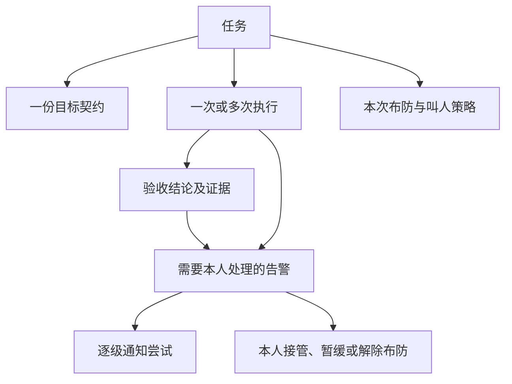
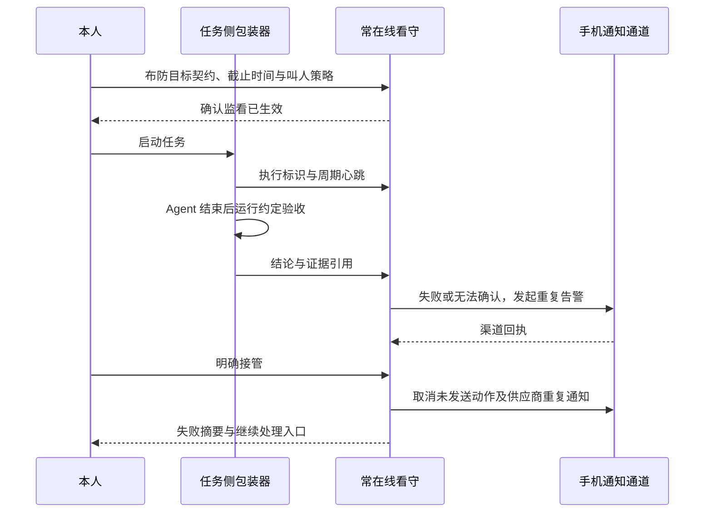

# MVP：任务失败，把本人叫回来

首版验证一个场景：本人睡前布防一个 Agent 任务；任务失联、异常结束且无有效验收通过结果、验收未通过或超过截止时间时，常在线的看守向本人手机重复告警；本人接管后停止本轮叫人，并拿到可继续处理的现场。

当前仓库只有设计，以下均为拟定行为。

## 任务的输入与输出

布防前固定一份目标契约和叫人策略。首版单人使用、单任务演练，先支持通用命令包装，再选择具体 Agent 的事件接口。

| 输入 | 约束 |
| --- | --- |
| 目标 | 用一句话说明要交付的结果。 |
| 验收条件 | 本人配置的检查命令、产物条件或明确人工验收项。首版先实现命令检查。 |
| 执行入口 | 本人在受信环境中指定的 Agent 命令与工作目录。 |
| 截止时间 | 明确到绝对时间；布防界面同时展示本地时区。 |
| 心跳期限 | 任务存活信号最晚何时必须到达；与业务进展分开记录。 |
| 叫人策略 | 本人设备、重复间隔、有效时间、次数及费用上限。 |
| 停止方式 | 接管、暂缓与解除布防入口；与该任务绑定。 |

输出保留目标契约、各次执行与验收结论、失败摘要、证据位置、通知尝试与本人操作。第三方通知默认只携带任务别名、失败类别和受保护的详情入口。

## 领域关系

任务的验收结论与告警处理状态分别保存：

| 维度 | 状态 | 含义 |
| --- | --- | --- |
| 验收结论 | 待验收 / 达成 / 未达成 / 无法确认 | 说明当前证据能支持什么结论。 |
| 告警状态 | 叫人中 / 暂缓 / 已接管 / 已解决 / 已解除布防 / 已耗尽策略 | 说明本轮叫人进行到哪里。 |

只有匹配当前目标契约与执行版本的验收通过，才写入「达成」并把对应告警标为「已解决」。接管与解除布防停止叫人，但保留「未达成」或「无法确认」。策略耗尽时，告警仍未解决。

## 触发条件与证据

| 信号 | 处理 | 通知中的事实 |
| --- | --- | --- |
| Agent 正常退出或声明完成 | 运行验收；通过则结束，失败则叫人。 | 退出码、失败的检查与证据位置。 |
| Agent 异常退出 | 保存异常并运行可用验收；没有有效通过结果则叫人。 | 真实退出码、验收结果与最后的已知步骤。 |
| 验收命令超时、环境故障或证据缺失 | 记录「无法确认」并叫人。 | 哪个检查无法完成及原因。 |
| 心跳超过期限 | 记录执行失联，叫人确认。 | 最后心跳时间；避免推断目标一定失败。 |
| 到达截止时间仍无有效通过结果 | 重新核对当前证据，再触发或更新告警。 | 截止时间和当前结论。 |
| 收到结构化的人工输入请求 | 叫人接管，目标仍待验收。 | 请求类型与任务入口。 |

结构化人工输入事件在 v0.2 接入；v0.1 通过截止时间覆盖长期等待。

首版不把自然语言中的「完成」或「卡住了」直接当成事实。命令检查只能证明约定条件成立；验收条件的充分性由本人决定，模型审查可在后续作为补充证据。

如果最终验收已通过，同一执行迟到的旧心跳超时事件不能重新拉响。后续新执行有自己的标识和验收记录。

## 一条最短链路

看守在任务开始前确认布防已生效。包装器来不及发送最终事件时，看守仍可按心跳和截止时间叫人。

看守与 Agent 进程独立。夜间使用建议把看守放到另一台常在线主机；本机模式用于开发演练，并明确显示休眠、关机和整机故障的覆盖缺口。独立看守自身故障的外部监测属于后续演练项。

## 首版的手机通道

优先验证 Pushover Emergency：它支持带重复间隔与过期时间的紧急消息，以及确认回执和取消重复通知接口。供应商重试有次数与时长限制，hell-mode 的有效期和预算须同时受这些限制约束。依据：[优先级 API](https://pushover.net/api#priority)、[回执与取消 API](https://pushover.net/api/receipts)。

供应商的「已确认」只记录为通知回执。本人需要在 hell-mode 的受保护入口明确选择处理方式，才进入「已接管」。若供应商确认已停止其内部重试，而本人仍未接管，看守继续按布防策略调度下一次提醒，直至本轮上限。

后续可评估：

| 候选 | 已查证的基础能力 | 集成前还要验证 |
| --- | --- | --- |
| [ntfy](https://docs.ntfy.sh/publish/) | HTTP 发布、优先级和动作按钮。 | 目标手机的及时触达、动作认证，以及重复提醒的调度方式。 |
| [Twilio Voice](https://www.twilio.com/docs/voice/api/call-resource) | 创建外呼与通话状态回调。 | 目标地区和号码可用性、账户要求、按键交互、费用和取消能力。 |
| [Home Assistant](https://contributors.home-assistant.io/core/internals/rest-api/) | REST 接口与服务调用。 | 本人设备支持的动作、状态回读与停止行为。 |

API 可用是技术选型依据。具体设备、静音模式、专注模式、联网情况和供应商限制仍需实机演练，不预设任何渠道必定能叫醒人。

## 接管交互

告警详情先展示目标、失败原因、等待时间及任务入口，再提供三个处理动作：

- **我来处理**：停止本轮告警，保留验收结论，打开现场。不会自动重跑 Agent。
- **稍后处理**：选择明确时间，当前告警进入暂缓；到点仍未处理则恢复。超出布防有效期时转为策略耗尽，并保留未解决记录。
- **放弃这个目标**：停止叫人，记录本人放弃和当时的验收结论。

「解除布防」始终可用。普通通知的点击、电话被语音信箱接通、供应商回执都不会自动触发接管。后续的二维码和清醒挑战只改变普通接管路径，不妨碍解除布防。

## 实现边界与恢复

首版建议由任务侧命令包装器、常在线看守和一个手机适配器组成。使用持久化任务记录与通知队列；SQLite 是单实例候选。暂不固定语言与 Agent SDK，先验证选定运行环境中的进程、网络和手机链路。

核心约束：

1. 同一失败的重复事件合并进当前告警；通知动作记录任务、执行、告警、档位与尝试标识，重启不把整个阶梯从头执行。
2. 发送前重新检查告警状态。接管后取消待发动作和供应商重试；已经送出的消息或正在振铃的电话单独记录取消结果。
3. 网络超时导致供应商结果不明时，记录「发送结果未知」，按供应商查询或幂等能力恢复；无法去重时采用有界重试并记录可能重复。
4. 通知失败与目标失败分别记录。可用时转向预先配置的备用通道，预算耗尽或全部通道不可用时保留未解决状态和最后错误。
5. 布防时冻结目标契约。执行中的 Agent 输出只能提交事件与证据，不能修改验收标准、接收人、费用上限或解除布防。
6. 验收命令由本人配置。通知回调只允许受认证的固定动作，不执行回调或模型输出携带的任意命令；接管链接绑定本轮告警并校验权限。
7. 叫人仅面向本人已验证设备。电话、音量、设备联动和计费操作逐项启用，按预览过的策略执行。

首版不包含自动修代码、自动部署、模型自主延长预算、通知同事或多人排班。任务恢复先提供现场和本人配置的入口，后续再讨论自动恢复。

## 首版验收场景

| 场景 | 预期结果 |
| --- | --- |
| Agent 退出码为 0，但约定验收失败 | 目标未达成，手机进入重复告警。 |
| 验收工具不可用 | 记录无法确认，附环境错误，不能报成功。 |
| 杀掉 Agent 和包装器，收不到结束事件 | 独立看守在心跳期限后叫人。 |
| 完整通过当前验收 | 记录达成，停止对应告警；旧事件不能复活它。 |
| 不点手机，等待本轮上限 | 按策略重复，最后记录策略耗尽且目标未解决。 |
| 仅在供应商客户端确认通知 | 留下回执；未接管时看守仍按策略继续。 |
| 重复投递事件或重启看守 | 恢复同一告警与进度，避免重复启动整轮叫人。 |
| 本人选择接管、暂缓或解除布防 | 状态和后续通知符合动作，验收结论不被改写。 |
| 通知 API 超时、拒绝请求或手机离线 | 记录对应证据；不把请求成功包装成本人已醒。 |
| 任务机休眠或断网 | 独立看守记录失联并用自身网络通知；本机模式如实暴露覆盖缺口。 |

任何真实夜间使用前，先在本人设备上完成白天演练，核对重复提醒、权限、接管停止、策略上限及日志脱敏。实机记录属于交付证据，命令模拟通过不能替代手机验收。
